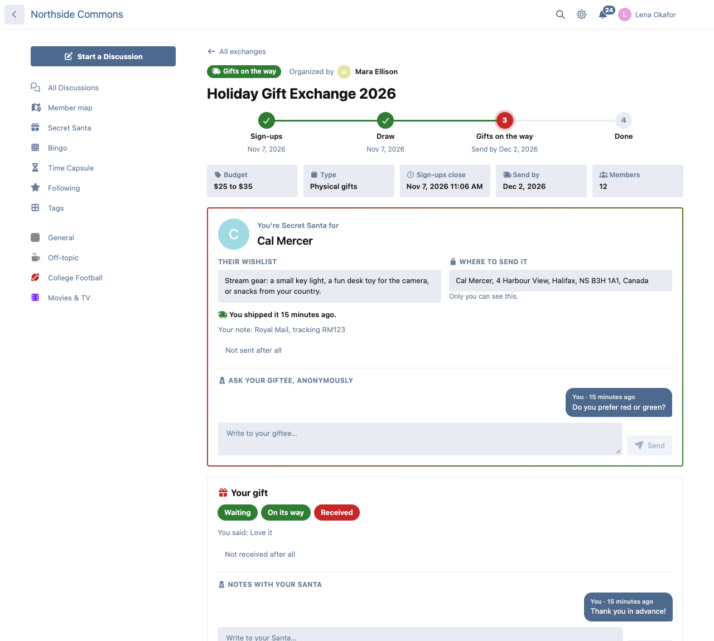
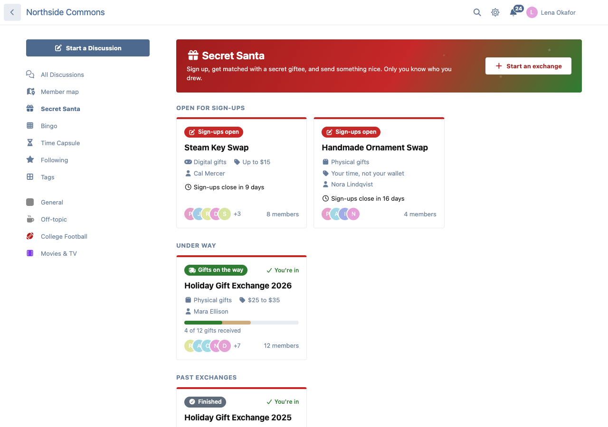
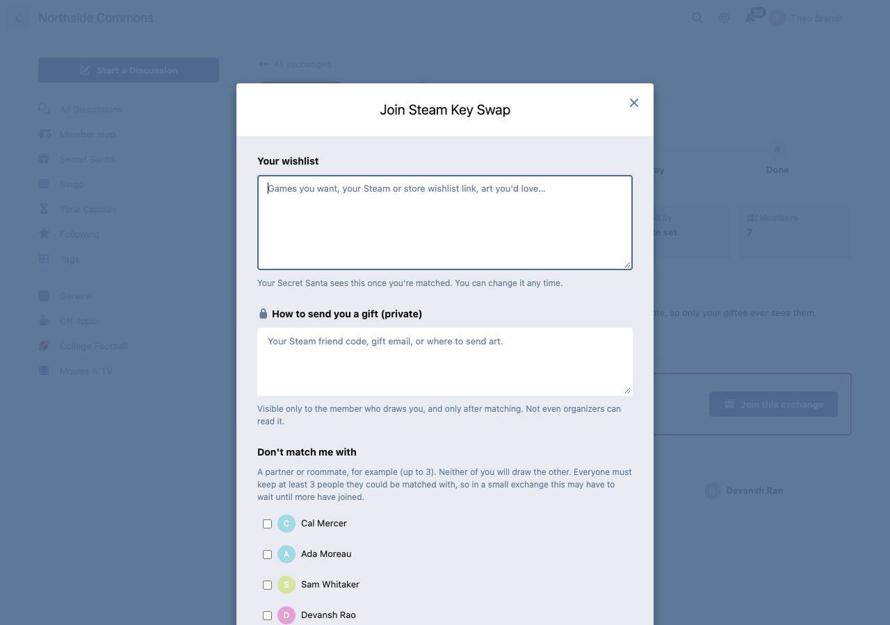
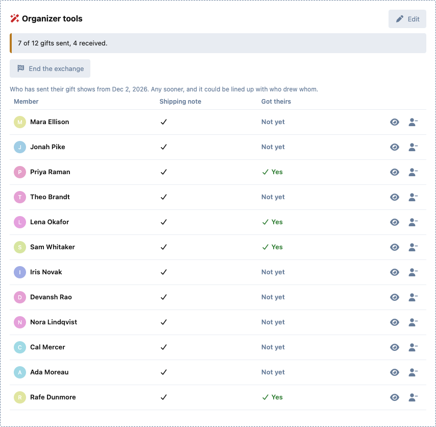

# Secret Santa

Gift exchanges for your Flarum 2 community: sign-ups, a fair secret draw, and gifts that arrive without anyone spoiling who sent them.

 [](https://packagist.org/packages/ernestdefoe/secret-santa)



- **Anyone can run one.** A member or moderator opens an exchange with a sign-up deadline, a budget, rules and a type: **physical** gifts that ship, or **digital** ones (Steam keys, gift cards, art trades).
- **Join with a wishlist** and a **private shipping note** (or, for digital exchanges, how to send you a gift). Only the member who draws you ever sees the note, and only after matching.
- **A fair draw, on time.** When sign-ups close, everyone is matched in one big circle, so nobody draws themselves and no two people just swap. **Exclusion pairs** keep couples and roommates apart. It runs on the scheduler, and on forums without a cron the next visit draws it.
- **Organizers stay in control without peeking.** Look the draw over before matches go out and draw again, add exclusions, close sign-ups early, handle a **dropout** (their Santa simply moves on to their giftee, and nobody learns a pair), and assign a **rescue Santa** if a giftee is left without one.
- **Anonymous notes** between each Santa and their giftee: "What size socks?" without giving the game away.
- **Shipped and received.** Santas mark their gift shipped, with an optional note (a tracking number, or the Steam key itself for digital gifts). Giftees mark it received and can leave a thank-you. Progress bars show how the whole exchange is going.
- **Notifications** (alerts and email): you're Secret Santa for X, your gift is on its way, a new note, your gift arrived, someone joined your exchange.


- **The fun ending.** A "show what you got" discussion in the tag you choose, and, if the organizer turns it on, everyone learns who their Santa was when the exchange ends.
- **A home for it all:** /secret-santa lists the exchanges open for sign-ups, under way and finished, each with a clear status.



## Privacy

Who drew whom is the whole point, so it is enforced on the server:

- Each member sees only their own match. Wishlists and shipping notes reach only their owner and their Santa.
- The draw needs at least 4 members and leaves everyone at least 3 people they could be matched with, so nobody can work out their Santa by elimination. Dropouts are repaired the same way: nobody, organizers included, learns a pair from it.
- Nobody else sees a pair: not other members, not organizers, not admins. There is no API resource for any of it, so no include or relationship path can reach it, and a giftee's notifications never carry their Santa.
- Organizers see who has sent and who has received as separate flags, never as pairs, and who has sent only from the send-by date. When something genuinely goes wrong, an organizer can **reveal one member's match**, with a reason, and every reveal is logged where all organizers can see it.
- With Flarum's GDPR extension, a member's entries are in their data export (without their Santa, unless the exchange unmasked it) and are removed on erasure.



The test suite checks every one of these against the API, core's own endpoints and notifications included.

## Permissions

View exchanges (guests by default), join, start an exchange (members), and run any exchange (moderators).

## Install

```sh
composer require ernestdefoe/secret-santa
```

For the draw to run exactly at the deadline, make sure Flarum's scheduler is set up (`php flarum schedule:run` every minute). Without it, the first visit after the deadline draws.

## Update

```sh
composer update ernestdefoe/secret-santa
php flarum migrate
php flarum cache:clear
```

## Links

- [Packagist](https://packagist.org/packages/ernestdefoe/secret-santa)
- [GitHub](https://github.com/ernestdefoe/secret-santa)

☕ If this saves you time, you can [buy me a coffee](https://buymeacoffee.com/ernestdefoe).
